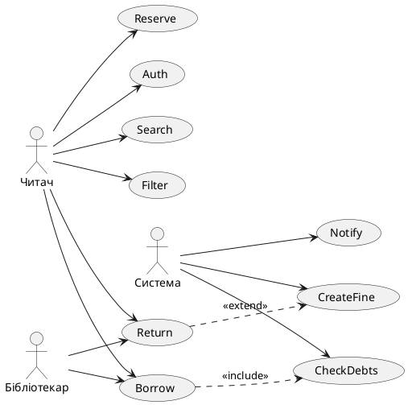

# AI-журнал - Завдання 2 (Вимоги та прецеденти)

## Ітерація 1: Формулювання вимог у форматі EARS

**Промт:**
> "Сформулюй функціональні вимоги для бібліотеки у форматі EARS. Потрібні вимоги для: автентифікації, пошуку книг, фільтрації, видачі, бронювання, повернення та штрафів."

**Отриманий результат від AI:**
- EARS-01: Система має автентифікувати користувача за email та паролем.
- EARS-02: Система має дозволяти пошук книг за назвою, автором та ISBN.
- EARS-03: Система має перевіряти борги читача перед видачею.
- EARS-04: Система має дозволяти бронювання книги, якщо примірник недоступний.
- EARS-05: Система має нараховувати штраф за прострочення повернення.
- EARS-06: Система має дозволяти повернення книги та оновлювати статус примірника.

**Аналіз результату:**
- AI запропонував 6 вимог у форматі EARS.
- Вимоги покривають основні сценарії: Auth, Search, Filter, Borrow, Reserve, Return, PayFine.
- Виявлено необхідність уточнення: FINE має бути окремою сутністю, а не атрибутом LOAN.

---

## Ітерація 2: Use case діаграма з include/extend

**Промт:**
> "Побудуй use case діаграму для бібліотеки. Використай include для перевірки боргів при видачі, extend для штрафу при поверненні. Актори: Читач, Бібліотекар, Система."

**Отриманий результат від AI:**

**Рішення, що прийнято:**
- UC_Borrow include UC_CheckDebts (перевірка боргів є частиною видачі).
- UC_Return extend UC_CreateFine (штраф нараховується при поверненні простроченої книги).
- Актори: Читач, Бібліотекар, Система.

---

## Ітерація 3: Матриця трасування

**Промт:**
> "Створи матрицю трасування: UC → EARS → Gherkin → Sequence → Activity → Component."

**Отриманий результат від AI:**
- Матриця включає 7 use cases, 6 EARS-вимог, 5 Gherkin-сценаріїв.
- Кожен UC простежується до конкретних артефактів.

**Висновок:**
- Трасування повне та консистентне.
- Створено trace-matrix.md з повним описом зв'язків.

---

## Підсумок рішень

| Use Case | EARS | Gherkin | Sequence |
|---|---|---|---|
| Auth | EARS-01 | scenarios.feature | S1 |
| Search | EARS-02 | scenarios.feature | S4 |
| Filter | EARS-02 | scenarios.feature | S4 |
| Borrow | EARS-03 | scenarios.feature | S1 |
| Reserve | EARS-04 | scenarios.feature | S3 |
| Return | EARS-05, EARS-06 | scenarios.feature | S2 |
| PayFine | EARS-05 | scenarios.feature | S2 |

**Коміти:** `677d47e`, `9ded1ac`, `2b87e72`