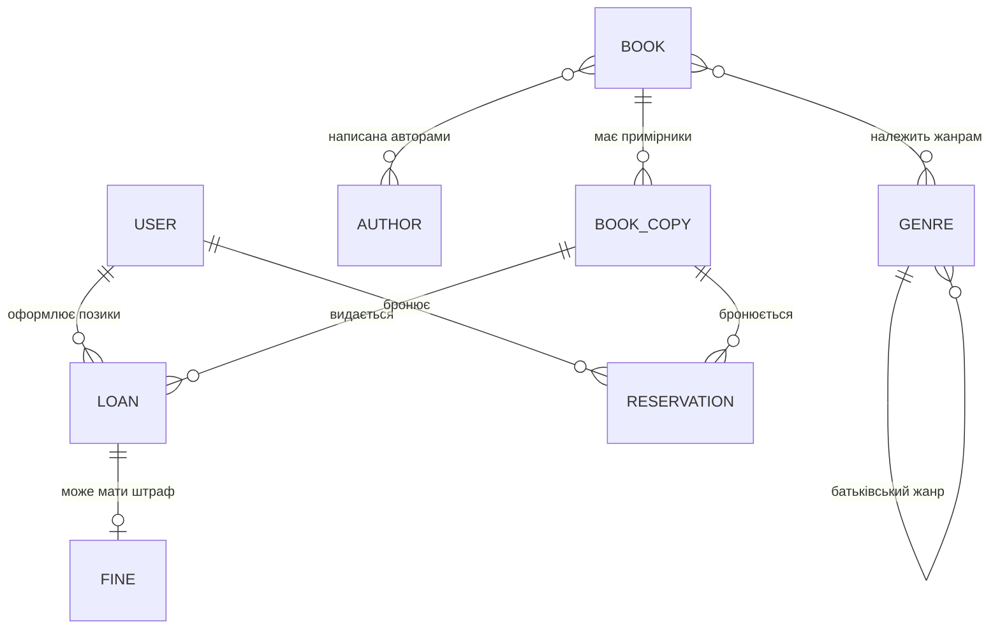

# Журнал взаємодії з AI (Prompt History) - Завдання 1

## Ітерація 1: Початковий запит на ER-модель

**Промт:**
> "Мені потрібно спроєктувати базу даних для бібліотеки. Зроби таблиці для книг, авторів, читачів, позик, бронювань і штрафів. Використай Mermaid erDiagram."

**Отриманий результат від AI:**

**Аналіз результату:**
- AI запропонував 12 сутностей.
- Ключові рішення: M:N між BOOK та AUTHOR через BOOK_AUTHOR, M:N між BOOK та GENRE (прямий).
- Виявлено проблему: BOOK_GENRE було включено як проміжна сутність, але згодом прибрано.

---

## Ітерація 2: Уточнення щодо жанрів та авторів

**Промт:**
> "Прибери BOOK_GENRE як окрему сутність. Зроби M:N між BOOK і GENRE прямим. Додай author_order у BOOK_AUTHOR."

**Отриманий результат від AI:**
- Підтверджено прямий M:N між BOOK і GENRE.
- Додано author_order (int) у BOOK_AUTHOR.
- Оновлено кардинальність: `BOOK }o--o{ GENRE`.

**Рішення, що прийнято:**
- BOOK_GENRE прибрано з кореневого spec.md.
- GENRE має self-reference (parent_id) для ієрархії жанрів.

---

## Ітерація 3: Перевірка цілісності

**Промт:**
> "Перевір, чи відповідає ER-модель 3NF. Чи правильно визначено PK/UK/FK?"

**Отриманий результат від AI:**
- Усі сутності відповідають 3NF.
- PK: UUID для кожної сутності.
- UK: USER.email, BOOK.isbn, GENRE.slug, BOOK_COPY.inventory_number.
- FK: всі зовнішні ключі коректно визначені.

**Висновок:**
- Модель готова до реалізації.
- Створено spec.md з повним описом PK/UK/FK.

---

## Підсумок рішень

| Сутність | PK | UK | FK |
|---|---|---|---|
| BOOK | id (UUID) | isbn | - |
| BOOK_COPY | id (UUID) | inventory_number | book_id → BOOK |
| AUTHOR | id (UUID) | - | - |
| BOOK_AUTHOR | (book_id, author_id) | - | book_id → BOOK, author_id → AUTHOR |
| USER | id (UUID) | email | - |
| MEMBER | user_id (PK/FK) | card_number | user_id → USER |
| LIBRARIAN | user_id (PK/FK) | employee_number | user_id → USER |
| LOAN | id (UUID) | - | member_id → MEMBER, book_copy_id → BOOK_COPY |
| RESERVATION | id (UUID) | - | member_id → MEMBER, book_copy_id → BOOK_COPY |
| FINE | id (UUID) | - | loan_id → LOAN |
| GENRE | id (UUID) | slug | parent_id → GENRE (Optional) |

**Коміти:** `a83f0a9`, `915e1f4`, `7d5afdd`