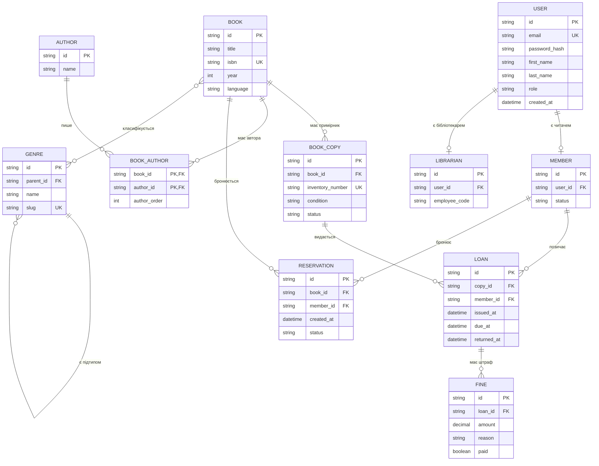

# ER-модель бібліотеки

BOOK_AUTHOR — асоціативна сутність: зв'язок BOOK ↔ AUTHOR несе власний атрибут author_order (правило 10), тому не зводиться до прямого M:N.
Розбіжність з spec.md: BOOK_GENRE не є сутністю (правило 9) — M:N BOOK ↔ GENRE показано прямим зв'язком; spec.md залишено без змін.
Концептуальна модель, без фізичної схеми (SQL DDL, ORM).