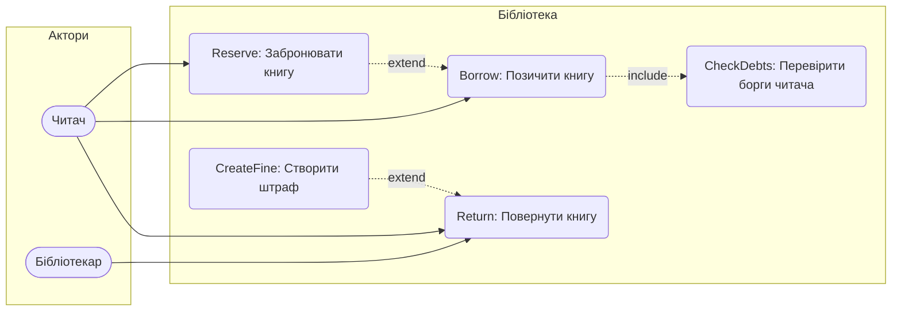

# Специфікація вимог та Use Cases бібліотеки (Завдання 2)

## Мета
Формалізувати функціональні вимоги до бібліотеки, побудувати модель Use Cases та забезпечити трасованість вимог до сутностей даних із Завдання 1 (`BOOK`, `BOOK_COPY`, `MEMBER`, `LOAN`, `RESERVATION`, `FINE`, `USER`), узгоджену з ER-моделлю та ADR 0004–0006.

## Артефакти
- [ears.md](ears.md) — EARS-01..06 (вимоги до позичення/повернення).
- [usecase.puml](usecase.puml) — UML Use Case діаграма (PlantUML).
- [scenarios.feature](scenarios.feature) — Gherkin-сценарії.
- [spec.md](spec.md) — специфікація завдання 2 (вимоги, NFR, трасування).
- [trace-matrix.md](trace-matrix.md) — матриця трасування (EARS ↔ UC ↔ Gherkin ↔ Sequence ↔ Activity ↔ Компоненти).
- [../spec.md](../spec.md) — специфікація (розд. 5–10, трасування).
- [../docs/adr/0004-fine-on-overdue.md](../docs/adr/0004-fine-on-overdue.md), [../docs/adr/0005-borrow-include-debts-check.md](../docs/adr/0005-borrow-include-debts-check.md), [../docs/adr/0006-fine-as-extend-on-return.md](../docs/adr/0006-fine-as-extend-on-return.md) — архітектурні рішення.

---

## 1. Актори системи (Actors)

| Актор | Тип | Опис |
| :--- | :--- | :--- |
| **Читач (Reader)** | Primary | Читач, який шукає книги, позичає, повертає, бронює. Узагальнення `USER` → `MEMBER` (ADR 0003). |
| **Бібліотекар (Librarian)** | Primary | Видає і приймає книги; участь у `Return`. |

Зовнішні сервіси (email/SMS, платіжний шлюз) не є акторами; штраф створює система. Адміністративна роль у поточному обсязі не моделюється.

---

## 2. Функціональні вимоги у форматі EARS

- **EARS-01 (Event-driven):** WHEN читач запитує видачу AND примірник доступний, THE SYSTEM SHALL створити видачу з терміном 14 днів.
- **EARS-02 (Unwanted Behavior):** IF читач має прострочені борги, THEN THE SYSTEM SHALL відмовити у видачі з повідомленням.
- **EARS-03 (Unwanted Behavior):** IF читач уже має 5 позичених книг, THEN THE SYSTEM SHALL відмовити у видачі.
- **EARS-04 (Event-driven):** WHEN примірника немає в наявності, THE SYSTEM SHALL запропонувати бронювання і створити `RESERVATION`.
- **EARS-05 (State-driven):** WHILE примірник має статус «на руках», THE SYSTEM SHALL блокувати його видачу і бронювання іншим читачам.
- **EARS-06 (Event-driven):** WHEN читач повертає прострочену книгу, THE SYSTEM SHALL створити `FINE` (extend від «Повернути книгу»).

Джерело: [ears.md](ears.md).

---

## 2.1. Нефункціональні вимоги (NFR)

- **NFR-01:** відповідь ≤ 2 с для 95% запитів при 200 одночасних.
- **NFR-02:** веб-інтерфейс desktop і мобільних.
- **NFR-03:** мова UI — українська.
- **NFR-04:** паролі хешуються bcrypt/argon2.

NFR трасуються до UC і сутностей у [trace-matrix.md](trace-matrix.md).

---

## 3. Gherkin-сценарії

Джерело: [scenarios.feature](scenarios.feature).

```gherkin
Feature: Позичення і повернення книги (EARS-01..06)

  Scenario: Успішна видача
    Given читач має 0 прострочених і 2 позичені книги
    And є доступний примірник
    When читач запитує видачу
    Then створюється видача з терміном 14 днів
    And статус примірника «на руках»

  Scenario: Книги немає → пропозиція забронювати
    Given читач запитує книгу, примірників немає
    When система перевіряє наявність
    Then пропонується бронювання
    And створюється RESERVATION

  Scenario: Є прострочені борги → відмова
    Given читач має прострочені видачі
    When читач запитує видачу
    Then система відмовляє з повідомленням

  Scenario: Перевищено ліміт 5 книг → відмова
    Given читач має 5 позичених книг
    When читач запитує видачу
    Then система відмовляє через перевищення ліміту

  Scenario: Повернення простроченої книги → штраф
    Given видача прострочена
    When читач повертає книгу
    Then створюється FINE

  Scenario: Примірник на руках блокується
    Given примірник має статус «на руках»
    When інший читач запитує його видачу
    Then система відмовляє, бо примірник недоступний
```

---

## 4. Use Case Model

### 4.1. Специфікація прецедентів використання (Таблиця)

| Use Case ID | Назва прецеденту | Актор | Тип зв'язку | Опис / Пов'язаний UC |
| :--- | :--- | :--- | :--- | :--- |
| **Borrow** | Позичити книгу | Читач | Primary | Видача примірника на 14 днів. include `CheckDebts`; extend `Reserve`. |
| **CheckDebts** | Перевірити борги читача | система | `<<include>>` | Перевірка прострочених боргів і ліміту 5. |
| **Return** | Повернути книгу | Читач, Бібліотекар | Primary | Повернення примірника. extend `CreateFine`. |
| **CreateFine** | Створити штраф | система | `<<extend>>` | Створення `FINE` при простроченні (ADR 0004, 0006). |
| **Reserve** | Забронювати книгу | Читач | `<<extend>>` | Бронювання за відсутності примірника. |

### 4.2. Use Case Diagram

Mermaid не має окремої нотації Use Case; тут використано `flowchart` для рендеру на GitHub. Еталонна UML-версія — [task-2/usecase.puml](usecase.puml).



---

## 5. Трасування

Детальна матриця — [trace-matrix.md](trace-matrix.md) (UC ↔ EARS ↔ Gherkin ↔ Sequence (task-3) ↔ Activity (task-4) ↔ Компоненти (task-5)).

Коротка відповідність: `EARS-01` → `Borrow` → «Успішна видача»; `EARS-02` → `CheckDebts` → «Є прострочені борги → відмова»; `EARS-03` → `Borrow` → «Перевищено ліміт 5 книг → відмова»; `EARS-04` → `Reserve` → «Книги немає → пропозиція забронювати»; `EARS-05` → `Borrow`/`Reserve` → «Примірник на руках блокується»; `EARS-06` → `Return`/`CreateFine` → «Повернення простроченої книги → штраф».

---

## 6. Архітектурні рішення

- [../docs/adr/0004-fine-on-overdue.md](../docs/adr/0004-fine-on-overdue.md) — `FINE` створюється лише при поверненні простроченої видачі.
- [../docs/adr/0005-borrow-include-debts-check.md](../docs/adr/0005-borrow-include-debts-check.md) — `Перевірити борги читача` як `<<include>>` до «Позичити книгу».
- [../docs/adr/0006-fine-as-extend-on-return.md](../docs/adr/0006-fine-as-extend-on-return.md) — `Створити штраф` як `<<extend>>` від «Повернути книгу» (уточнення ADR 0004).

---

## 7. Як переглянути діаграми

- [ears.md](ears.md), [scenarios.feature](scenarios.feature), [spec.md](spec.md), [trace-matrix.md](trace-matrix.md) — Markdown/Gherkin, читаються як текст на GitHub.
- [usecase.puml](usecase.puml) — PlantUML; потребує PlantUML-рендерера або розширення IDE. Файли `.puml` на GitHub не рендеряться; Mermaid-блок (розд. 4.2) рендериться безпосередньо.
- UC-діаграма подана як PlantUML (`usecase.puml`) і дубльована Mermaid-`flowchart` (розд. 4.2), оскільки Mermaid не відтворює генералізацію акторів повністю.

---

## 8. Перевірка

- EARS-01..06 узгоджені з [usecase.puml](usecase.puml) і [scenarios.feature](scenarios.feature).
- `include` для перевірки боргів (`CheckDebts`) і `extend` для «Створити штраф» та «Забронювати книгу».
- Акторами залишено лише Читача і Бібліотекаря (зовнішні сервіси не актори).
- NFR-01..NFR-04 трасуються до UC і сутностей у [trace-matrix.md](trace-matrix.md).
- Кожен Use Case має щонайменше одну вимогу EARS (див. [spec.md](spec.md), розд. 5).

---

## 9. Обмеження (поза обсягом)

- Електронні книги, міжбібліотечний обмін, фізична логістика.
- Оплата штрафів через зовнішній платіжний шлюз може бути додана пізніше.
- Адміністративна роль не моделюється як актор.
