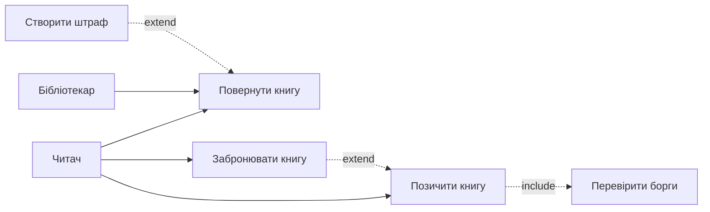

# Завдання 2 - Use Cases і вимоги бібліотеки

Актори, EARS-вимоги, Gherkin-сценарії, UC-діаграма. Деталі - у [spec.md](../spec.md).

**Аудит:** акторами є лише Читач і Бібліотекар; платіжний шлюз/email - не актори.

## UC-діаграма (Mermaid)

