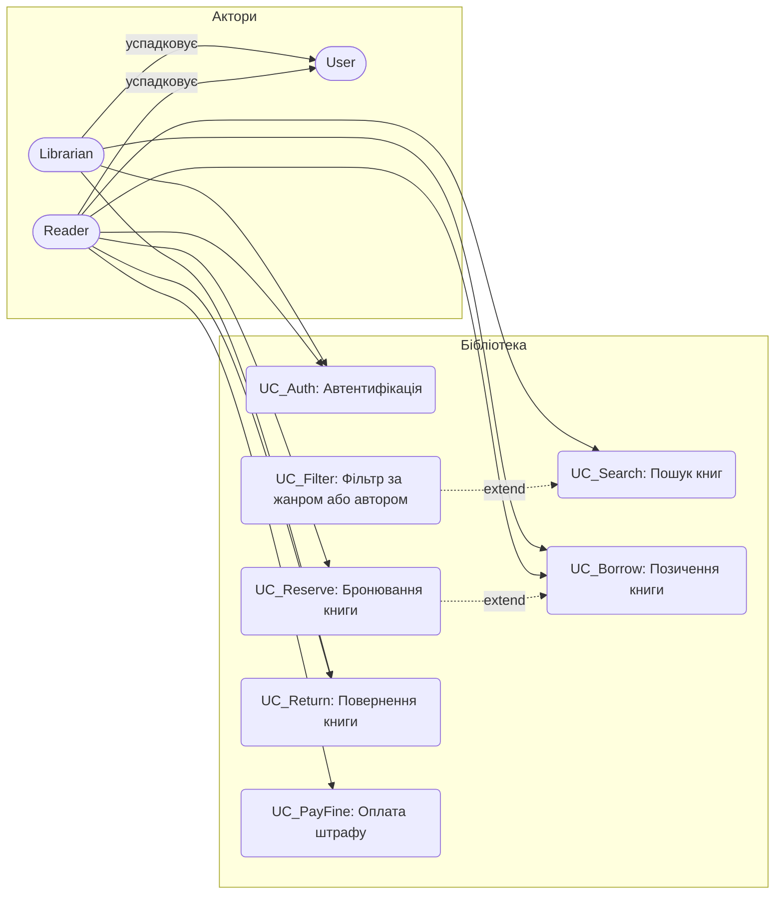

# Специфікація вимог та Use Cases бібліотеки (Завдання 2)

## Артефакти
- [usecase.puml](usecase.puml) — UML Use Case діаграма (PlantUML).
- [spec.md](spec.md) — специфікація завдання 2 (вимоги, Use Cases, NFR, Out of Scope).
- [ears.md](ears.md) — EARS-01..EARS-11.
- [scenarios.feature](scenarios.feature) — Gherkin-сценарії (`# language: uk`, `Rule`, `Scenario Outline`).
- [trace-matrix.md](trace-matrix.md) — матриця трасування.
- [DEFENSE.md](DEFENSE.md) — матеріали захисту.
- [../task-1/spec.md](../task-1/spec.md) і [../task-1/er.md](../task-1/er.md) — ERD як вхід.

## 1. Актори системи (Actors)

| Актор | Тип | Опис |
| :--- | :--- | :--- |
| **User** | Abstract | Абстрактний базовий актор (спільна автентифікація, ADR 0003). |
| **Reader** | Primary | Читач, який шукає книги, позичає, повертає, бронює, оплачує штрафи. Успадковує `User`. |
| **Librarian** | Primary | Бібліотекар, який видає і приймає книги (участь у `UC_Borrow`/`UC_Return`). Успадковує `User`. |

Зовнішні сервіси Payment Gateway і System Timer не актори; їхні дії описано як умови EARS-10/EARS-11 (`spec.md`, розд. 3).

## 2. Функціональні вимоги у форматі EARS

- **EARS-01 (Подієва):** КОЛИ `Reader` запитує видачу І примірник доступний, ТО система ПОВИННА створити `LOAN` з терміном 14 днів.
- **EARS-02 (Небажана ситуація):** ЯКЩО `Reader` має прострочені борги, ТО система ПОВИННА відмовити у видачі з повідомленням.
- **EARS-03 (Небажана ситуація):** ЯКЩО `Reader` уже має 5 активних позик, ТО система ПОВИННА відмовити у видачі.
- **EARS-04 (Подієва):** КОЛИ примірника немає в наявності, ТО система ПОВИННА запропонувати бронювання і створити `RESERVATION`.
- **EARS-05 (Станова):** ПОКИ примірник має статус «на руках», система ПОВИННА блокувати його видачу і бронювання іншим `Reader`.
- **EARS-06 (Подієва):** КОЛИ `Reader` повертає прострочену книгу, ТО система ПОВИННА створити `FINE`.
- **EARS-07 (Подієва):** КОЛИ `Reader` або `Librarian` вводить валідні облікові дані, ТО система ПОВИННА перевірити запис у `USER` і надати доступ відповідно до ролі (`UC_Auth`).
- **EARS-08 (Подієва):** КОЛИ користувач вводить пошуковий запит, ТО система ПОВИННА повернути список `BOOK`, що відповідає запиту (`UC_Search`).
- **EARS-09 (Подієва):** КОЛИ користувач застосовує фільтр за жанром або автором, ТО система ПОВИННА уточнити результати пошуку і повернути відфільтрований список `BOOK` (`UC_Filter`, extend від `UC_Search`).
- **EARS-10 (Подієва):** КОЛИ користувач ініціює оплату штрафу, ТО система ПОВИННА обробити платіж через зовнішній платіжний сервіс і, при успіху, встановити `FINE.paid` = true (`UC_PayFine`).
- **EARS-11 (Подієва):** КОЛИ настає термін прострочення `LOAN`, ТО система ПОВИННА позначити `LOAN` як прострочений і МОЖЕ надіслати нагадування; `FINE` створюється лише при поверненні (`EARS-06`). Деталі таймера — припущення.

## 2.1. Нефункціональні вимоги (NFR)

- **NFR-01 (продуктивність):** система ПОВИННА опрацьовувати 95% запитів не довше 2 с при щонайменше 200 одночасних користувачів. Умови вимірювання: профіль — типові операції бібліотеки (пошук, видача, повернення); обсяг — 200 одночасних користувачів; метод — навантажувальний тест протягом 30 хв. Припущення: пороги не мають окремого ADR.
- **NFR-02 (сумісність інтерфейсу):** інтерфейс ПОВИНЕН бути придатним для роботи на екранах desktop і мобільних пристроїв. Умови вимірювання: профіль — сучасні браузери; обсяг — основні екрани системи; метод — ручне/автоматизоване тестування інтерфейсу на різних розмірах екранів. Припущення.
- **NFR-03 (локалізація):** інтерфейс ПОВИНЕН бути україномовним. Умови вимірювання: профіль — усі екрани і повідомлення; метод — огляд інтерфейсу. Припущення.
- **NFR-04 (безпека):** паролі ПОВИННІ зберігатися у вигляді хешу (bcrypt або argon2). Умови вимірювання: об'єкт — поле `USER.password_hash`; метод — аудит коду/тест. Припущення.

## 2.2. Користувачі та контекст використання

### Профілі користувачів

| Актор | Хто це | Основні цілі | Технічний рівень | Типові пристрої | Частота використання |
| :--- | :--- | :--- | :--- | :--- | :--- |
| `Reader` | Читач з обліковим записом `MEMBER` | Шукати книги, позичати, повертати, бронювати, оплачувати штрафи | Середній | Смартфон і ПК | Кілька разів на тиждень |
| `Librarian` | Працівник бібліотеки | Видавати і приймати книги | Середній | ПК | Щодня |

Не є людьми: зовнішній платіжний сервіс і системний таймер.

### Типові сценарії використання

- **Читач (`Reader`):** пошук → видача або бронювання → повернення → оплата штрафу.
- **Бібліотекар (`Librarian`):** вхід → видача примірника → приймання повернення.

### Навантаження та контекст

- Пікове навантаження очікується у години активного відвідування; робота системи має відповідати NFR-01.
- Інтерфейс призначений для користувачів України, тому українська мова (NFR-03) є базовою вимогою.

## 3. User Stories & Gherkin Scenarios

Джерело: [scenarios.feature](scenarios.feature) (`# language: uk`, `Rule`, `Scenario Outline`).

```gherkin
# language: uk

Функціонал: Позичення і повернення книги (EARS-01..EARS-06)

  Правило: Читач із простроченими боргами не отримує видачу

    Приклад: Відмова при прострочених боргах

      Дано читач має прострочені видачі
      Коли читач запитує видачу
      Тоді система відмовляє з повідомленням

  Правило: Не більше 5 активних позик на одного читача

    Приклад: Відмова при 5 активних позиках

      Дано читач має 5 позичених книг
      І є доступний примірник
      Коли читач запитує видачу
      Тоді система відмовляє через перевищення ліміту

  Правило: Повернення простроченої книги створює FINE

    Приклад: Створення FINE при поверненні простроченої книги

      Дано видача прострочена
      Коли бібліотекар приймає повернення книги
      Тоді створюється FINE

  Сценарій: Успішна видача на 14 днів

    Дано читач має 0 прострочених і 2 позичені книги
    І бібліотекар підтверджує наявність примірника
    Коли читач запитує видачу
    Тоді створюється видача з терміном 14 днів
    І статус примірника «на руках»

  Сценарій: Книги немає → бронювання

    Дано читач запитує книгу, примірників немає
    Коли система перевіряє наявність
    Тоді пропонується бронювання
    І створюється RESERVATION

  Сценарій: Примірник на руках блокується

    Дано примірник має статус «на руках»
    Коли інший читач запитує його видачу
    Тоді система відмовляє, бо примірник недоступний

  Структура сценарію: Видача з урахуванням активних позик і терміну 14 днів

    Дано читач має <активні> активні позики
    І примірник доступний
    Коли читач запитує видачу
    Тоді створюється видача з терміном <днів> днів
    І статус примірника «на руках»

    Приклади:

      | активні | днів |
      | 0       | 14   |
      | 2       | 14   |
      | 4       | 14   |

  Структура сценарію: Відмова при перевищенні ліміту 5 позик

    Дано читач має <активні> активні позики
    І є доступний примірник
    Коли читач запитує видачу
    Тоді система відмовляє через перевищення ліміту

    Приклади:

      | активні |
      | 5       |
      | 6       |
```

## 4. Use Case Model

### 4.1. Специфікація прецедентів використання (Таблиця)

| Use Case | Актор | Опис | Зв'язки |
| :--- | :--- | :--- | :--- |
| `UC_Auth` | `Reader`, `Librarian` | Автентифікація за валідними обліковими даними | — |
| `UC_Search` | `Reader` | Пошук книг за запитом | — |
| `UC_Filter` | `Reader` | Фільтр за жанром або автором | `extend` від `UC_Search` |
| `UC_Borrow` | `Reader`, `Librarian` | Позичення примірника на 14 днів (містить перевірку боргів і ліміту EARS-02, EARS-03) | — |
| `UC_Reserve` | `Reader` | Бронювання за відсутності примірника | `extend` від `UC_Borrow` |
| `UC_Return` | `Reader`, `Librarian` | Повернення примірника; при простроченні створюється `FINE` (EARS-06) | — |
| `UC_PayFine` | `Reader` | Оплата штрафу через зовнішній платіжний сервіс (EARS-10) | — |

`EARS-11` реалізується системним процесом за розкладом (поза діаграмою `usecase.puml`, бо не ініціюється актором). Внутрішні дії (перевірка боргів, створення `FINE`, прострочення) є вимогами EARS, а не окремими прецедентами.

### 4.2. Use Case Diagram

Mermaid не має окремої нотації Use Case; тут використано `flowchart` для рендеру на GitHub. Еталонна UML-версія — [usecase.puml](usecase.puml).



## 5. Трасування

Детальна матриця — [trace-matrix.md](trace-matrix.md) (UC ↔ EARS ↔ Gherkin ↔ Sequence (task-3) ↔ Activity (task-4) ↔ Компоненти (task-5)). Коротка відповідність: `EARS-01` → `UC_Borrow`; `EARS-02`, `EARS-03` → `UC_Borrow`; `EARS-04` → `UC_Borrow`, `UC_Reserve`; `EARS-05` → `UC_Borrow`; `EARS-06` → `UC_Return`; `EARS-07` → `UC_Auth`; `EARS-08` → `UC_Search`; `EARS-09` → `UC_Filter`; `EARS-10` → `UC_PayFine`; `EARS-11` → системний процес за розкладом (поза діаграмою).

## 6. Обмеження й припущення

- Оплата штрафів делегується зовнішньому платіжному сервісу; система лише фіксує результат (`FINE.paid`) (EARS-10). Деталі платіжного потоку `PayFine` не зафіксовані в ADR — припущення.
- Системний процес за розкладом лише позначає `LOAN` як прострочений і/або надсилає нагадування (EARS-11); `FINE` створюється при поверненні з простроченням (EARS-06, ADR 0004/0006). Деталі таймера не зафіксовані — припущення.
- NFR-пороги не мають окремого ADR — припущення.
- Система не веде фізичну інвентаризацію примірників; `BOOK_COPY.status` — логічний стан.
- Система не підтримує електронні книги, міжбібліотечний обмін, фізичну логістику (`../spec.md`, розд. 8).
- Адміністративна роль поза обсягом.
- ADR 0009 — лише контекст розгортання (модульний моноліт, API-шлюз, адаптери, outbox), не обґрунтування оплати.

## 7. Як перевірити

- Відкрити [usecase.puml](usecase.puml) у PlantUML.
- Відкрити [scenarios.feature](scenarios.feature) у Gherkin-рендері.
- Перевірити наявність `UC_Auth`, `UC_Search`, `UC_Filter`, `UC_Borrow`, `UC_Reserve`, `UC_Return`, `UC_PayFine` у [usecase.puml](usecase.puml).
- Перевірити наявність `EARS-01..EARS-11` у [ears.md](ears.md) і [spec.md](spec.md).
- Перевірити трасування у [trace-matrix.md](trace-matrix.md).

## 8. Посилання

- [../task-1/spec.md](../task-1/spec.md)
- [../task-1/er.md](../task-1/er.md)
- [usecase.puml](usecase.puml)
- [ears.md](ears.md)
- [scenarios.feature](scenarios.feature)
- [trace-matrix.md](trace-matrix.md)
- [DEFENSE.md](DEFENSE.md)
- [../spec.md](../spec.md)
- [../docs/adr/0003-user-generalization.md](../docs/adr/0003-user-generalization.md)
- [../docs/adr/0004-fine-on-overdue.md](../docs/adr/0004-fine-on-overdue.md)
- [../docs/adr/0005-borrow-include-debts-check.md](../docs/adr/0005-borrow-include-debts-check.md)
- [../docs/adr/0006-fine-as-extend-on-return.md](../docs/adr/0006-fine-as-extend-on-return.md)
- [../docs/adr/0007-sequence-per-scenario.md](../docs/adr/0007-sequence-per-scenario.md)
- [../docs/adr/0008-activity-fork-join-status.md](../docs/adr/0008-activity-fork-join-status.md)
- [../docs/adr/0009-modular-monolith-api-gateway-adapters-outbox.md](../docs/adr/0009-modular-monolith-api-gateway-adapters-outbox.md)
- [../docs/adr/0010-outbox-after-commit-email.md](../docs/adr/0010-outbox-after-commit-email.md)
```<|end|><|start|>write to=assistant<|channel|>analysis<|message|>analysis<|message|>Now verify. Run grep forbidden terms. Need be careful grep command maybe case-insensitive? We'll run default case-sensitive and maybe case-insensitive. Also check links existence. Let's run a PowerShell script to extract markdown links and verify. Also grep.<|end|><|start|>start-tool-shell<|message|>analysis <|constrain|>xml<|message|><rfl:parameter name="command">
