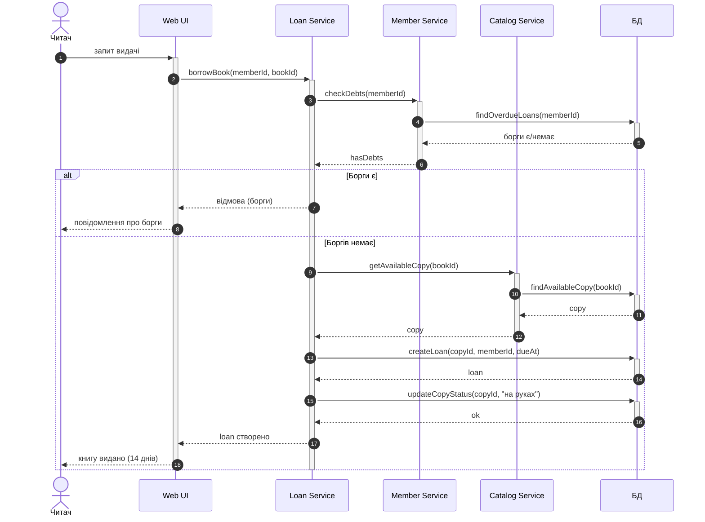
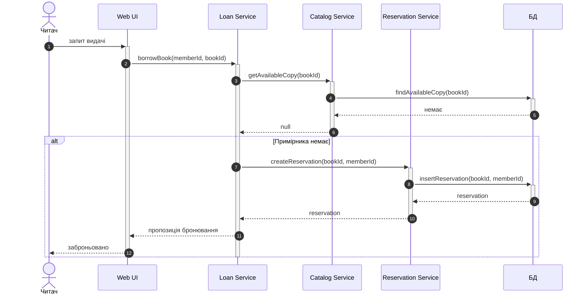
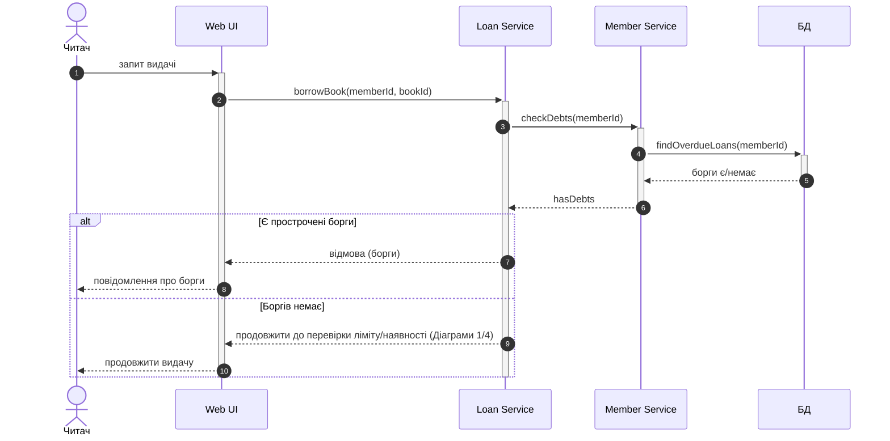
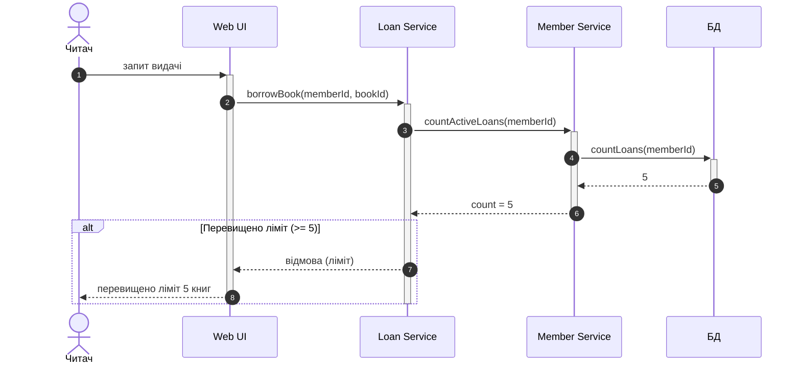
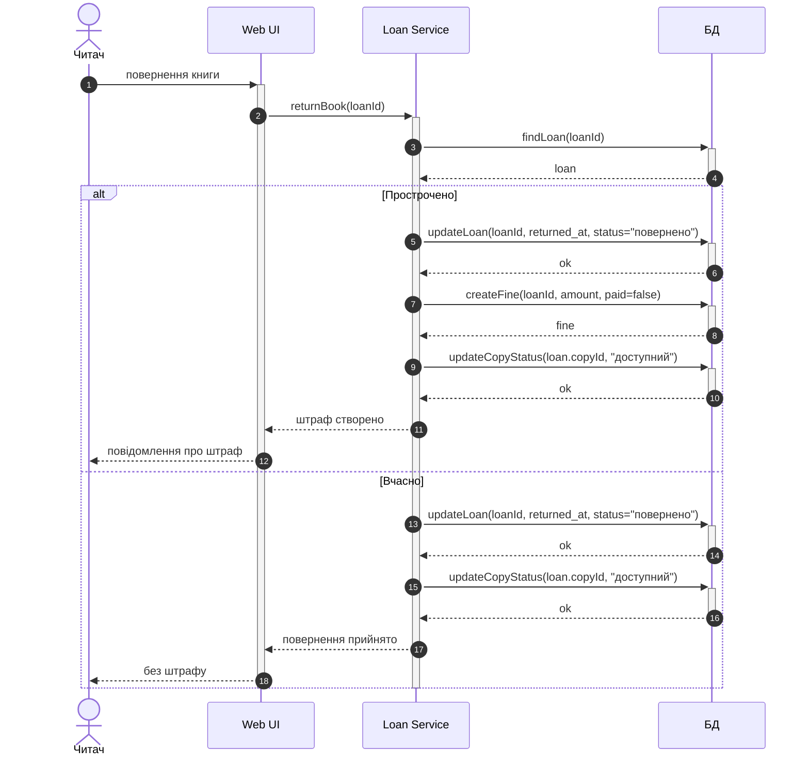

# Sequence-діаграми: позичення книги

**Аудит:** activation bars збалансовані: відкриття/закриття відповідають, фінальні `deactivate` стоять після `end`; учасники узгоджені з ER-моделлю.

## Діаграма 1. Успішна видача

## Діаграма 2. Примірника немає → бронювання

## Діаграма 3. Відмова через борги

## Діаграма 4. Перевищено ліміт 5 книг

## Діаграма 5. Повернення простроченої книги → `FINE`

