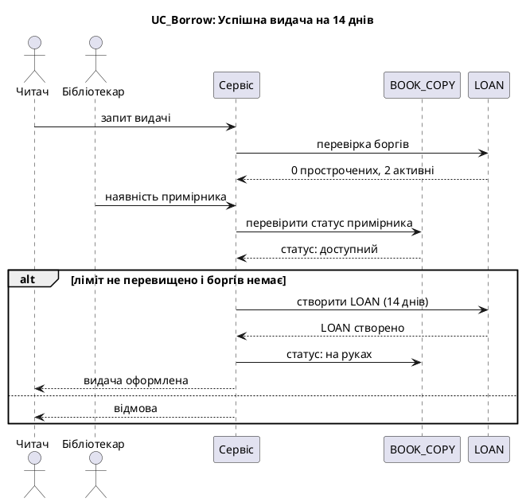
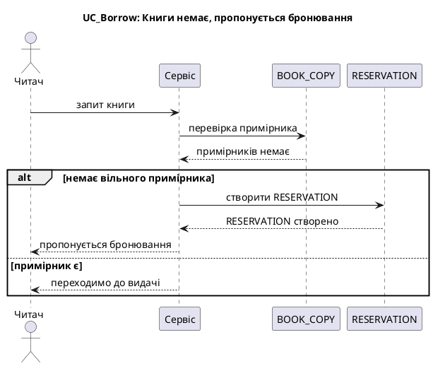
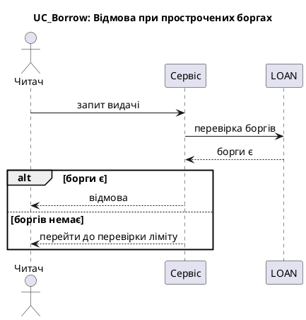
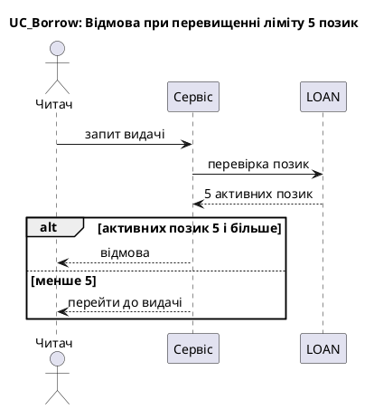
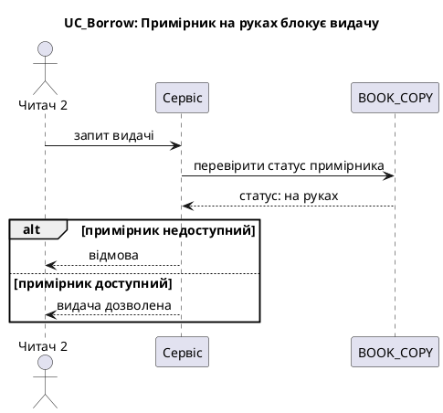

# Діаграми послідовності: UC_Borrow (Завдання 3)

Діаграми описують п'ять сценаріїв UC_Borrow; код дослівно з task-3/sequence.puml; рендер PlantUML.

## S1. Успішна видача (EARS-01)

Діаграма показує успішну видачу книги на 14 днів при відсутності боргів і неперевищенні ліміту.

## S2. Книги немає → пропозиція забронювати (EARS-04)

Діаграма показує пропозицію бронювання, коли вільного примірника немає.

## S3. Є прострочені борги → відмова (EARS-02)

Діаграма показує відмову у видачі при наявності прострочених боргів.

## S4. Перевищено ліміт 5 книг → відмова (EARS-03)

Діаграма показує відмову у видачі при перевищенні ліміту активних позик.

## S5. Примірник на руках блокується (EARS-05)

Діаграма показує блокування видачі примірника, що вже на руках.