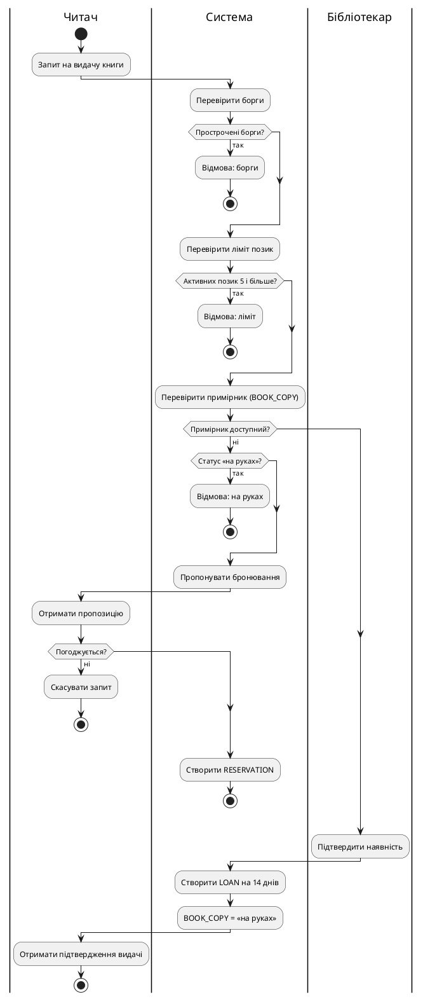

# Діаграма діяльності: Видача книги (Завдання 4)

Короткий вступ: діаграма описує бізнес-процес UC_Borrow з усіма сценаріями Gherkin (S1-S5) на одній діаграмі; форма - діаграма діяльності (PlantUML activity); смуги за ролями.

## activity-borrow

Пояснення шляхів: S1 Успішна видача - примірник доступний, бібліотекар підтверджує, створюється LOAN на 14 днів, BOOK_COPY = «на руках». S2 Бронювання - примірник недоступний, пропонується бронювання; при згоді створюється RESERVATION, інакше запит скасовується. S3 Відмова через борги - прострочені борги, відмова. S4 Відмова через ліміт - 5 і більше активних позик, відмова. S5 Блокування примірника - примірник недоступний і має статус «на руках», відмова.

## Як переглянути

Відкрити activity.puml у PlantUML або activity.md у markdown-рендері з підтримкою plantuml.
