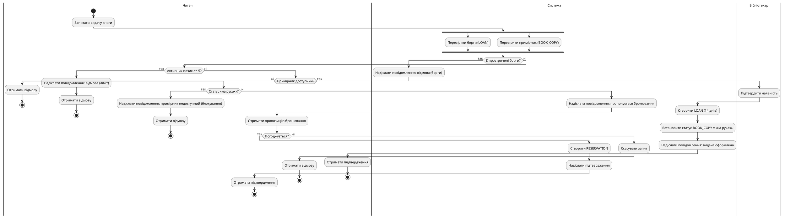

# Діаграма діяльності: Видача книги (Завдання 4)

Короткий вступ: діаграма описує бізнес-процес UC_Borrow з усіма сценаріями Gherkin (S1-S5) на одній діаграмі; форма - діаграма діяльності (PlantUML activity); смуги за ролями.

## activity-borrow

Пояснення шляхів: S1 Успішна видача - примірник доступний, створюється видача, встановлення статусу і повідомлення. S2 Бронювання - примірник недоступний, пропонується бронювання, повідомлення читачу, завершення. S3 Відмова через борги - прострочені борги, повідомлення, завершення. S4 Відмова через ліміт - 5 позичених, повідомлення, завершення. S5 Блокування примірника - примірник недоступний (статус «на руках»), відмова з повідомленням, завершення. Повідомлення читачу завершує кожну гілку.

## Як переглянути

Відкрити activity.puml у PlantUML або activity.md у markdown-рендері з підтримкою plantuml.