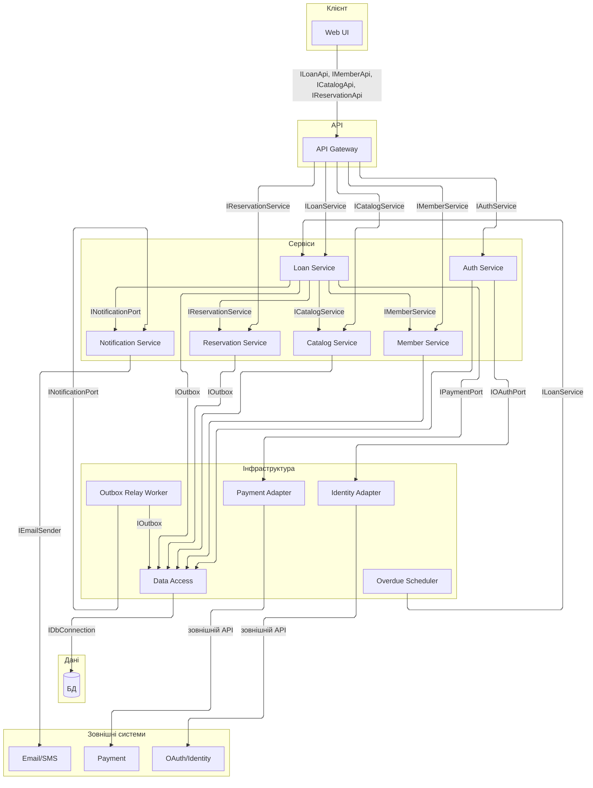

# Component Diagram: архітектура бібліотеки (Завдання 5)

## Інтерфейси (provided / required)

| Інтерфейс | Provided by | Required by | Призначення |
| :--- | :--- | :--- | :--- |
| `ILoanApi` | API Gateway | Web UI | `borrowBook`, `returnBook` через API |
| `IMemberApi` | API Gateway | Web UI | профіль читача |
| `ICatalogApi` | API Gateway | Web UI | каталог книг |
| `IReservationApi` | API Gateway | Web UI | бронювання |
| `ILoanService` | Loan Service | API Gateway, Overdue Scheduler | `borrowBook`, `returnBook`, прострочення |
| `IMemberService` | Member Service | API Gateway, Loan Service | дані читача |
| `ICatalogService` | Catalog Service | API Gateway, Loan Service | каталог |
| `IReservationService` | Reservation Service | API Gateway, Loan Service | `createReservation` |
| `IAuthService` | Auth Service | API Gateway | автентифікація |
| `IPaymentPort` | Payment Adapter | Loan Service | оплата штрафу |
| `IOAuthPort` | Identity Adapter | Auth Service | автентифікація через OAuth |
| `INotificationPort` | Notification Service | Loan Service, Outbox Relay Worker | `sendLoanCreated`, `sendReminder` |
| `IEmailSender` | Email/SMS (зовнішній) | Notification Service | надсилання email/SMS |
| `IOutbox` | Data Access | Loan Service, Reservation Service, Outbox Relay Worker | події повернення/бронювання |
| `IDbConnection` | БД | Data Access | доступ до БД |

## Інтерфейси (Mermaid)

```mermaid
flowchart LR
    WebUI[Web UI] -.->|requires| ILoanApi((ILoanApi))
    Gateway[API Gateway] ---|provides| ILoanApi
    WebUI -.->|requires| IMemberApi((IMemberApi))
    Gateway ---|provides| IMemberApi
    WebUI -.->|requires| ICatalogApi((ICatalogApi))
    Gateway ---|provides| ICatalogApi
    WebUI -.->|requires| IReservationApi((IReservationApi))
    Gateway ---|provides| IReservationApi

    Gateway -.->|requires| ILoanService((ILoanService))
    LoanService[Loan Service] ---|provides| ILoanService
    OverdueScheduler[Overdue Scheduler] -.->|requires| ILoanService

    Gateway -.->|requires| IMemberService((IMemberService))
    MemberService[Member Service] ---|provides| IMemberService
    LoanService -.->|requires| IMemberService

    Gateway -.->|requires| ICatalogService((ICatalogService))
    CatalogService[Catalog Service] ---|provides| ICatalogService
    LoanService -.->|requires| ICatalogService

    Gateway -.->|requires| IReservationService((IReservationService))
    ReservationService[Reservation Service] ---|provides| IReservationService
    LoanService -.->|requires| IReservationService

    Gateway -.->|requires| IAuthService((IAuthService))
    AuthService[Auth Service] ---|provides| IAuthService

    LoanService -.->|requires| IPaymentPort((IPaymentPort))
    PaymentAdapter[Payment Adapter] ---|provides| IPaymentPort

    AuthService -.->|requires| IOAuthPort((IOAuthPort))
    IdentityAdapter[Identity Adapter] ---|provides| IOAuthPort

    LoanService -.->|requires| INotificationPort((INotificationPort))
    OutboxRelay[Outbox Relay Worker] -.->|requires| INotificationPort
    NotificationService[Notification Service] ---|provides| INotificationPort

    NotificationService -.->|requires| IEmailSender((IEmailSender))
    EmailSMS[Email/SMS] ---|provides| IEmailSender

    LoanService -.->|requires| IOutbox((IOutbox))
    ReservationService[Reservation Service] -.->|requires| IOutbox
    OutboxRelay -.->|requires| IOutbox
    DataAccess[Data Access] ---|provides| IOutbox

    DataAccess -.->|requires| IDbConnection((IDbConnection))
    DB[БД] ---|provides| IDbConnection
```

## Примітки

* `Auth Service` виконує автентифікацію через `Identity Adapter` (`IOAuthPort`); прямі виклики до `OAuth/Identity` заборонені.
* `Loan Service` реалізує видачу/повернення: перевірка боргів/ліміту (Member Service), вибір примірника, створення `LOAN`, оновлення `BOOK_COPY.status`, створення `FINE` за прострочення (ADR 0004).
* `Outbox Relay Worker` зчитує `IOutbox` після коміту і ініціює `Notification Service`; збій відправки не відкочує операцію.
* `Overdue Scheduler` періодично знаходить прострочені `LOAN` і створює `FINE` (ADR 0004), надсилає нагадування через outbox.
* `Payment`, `OAuth/Identity`, `Email/SMS` доступні лише через `Payment Adapter`, `Identity Adapter`, `Notification Service`.
* Детальні інтерфейси узгоджені з `component.puml` і `spec.md` §4.
