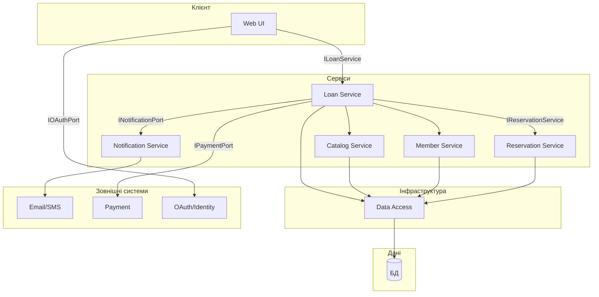
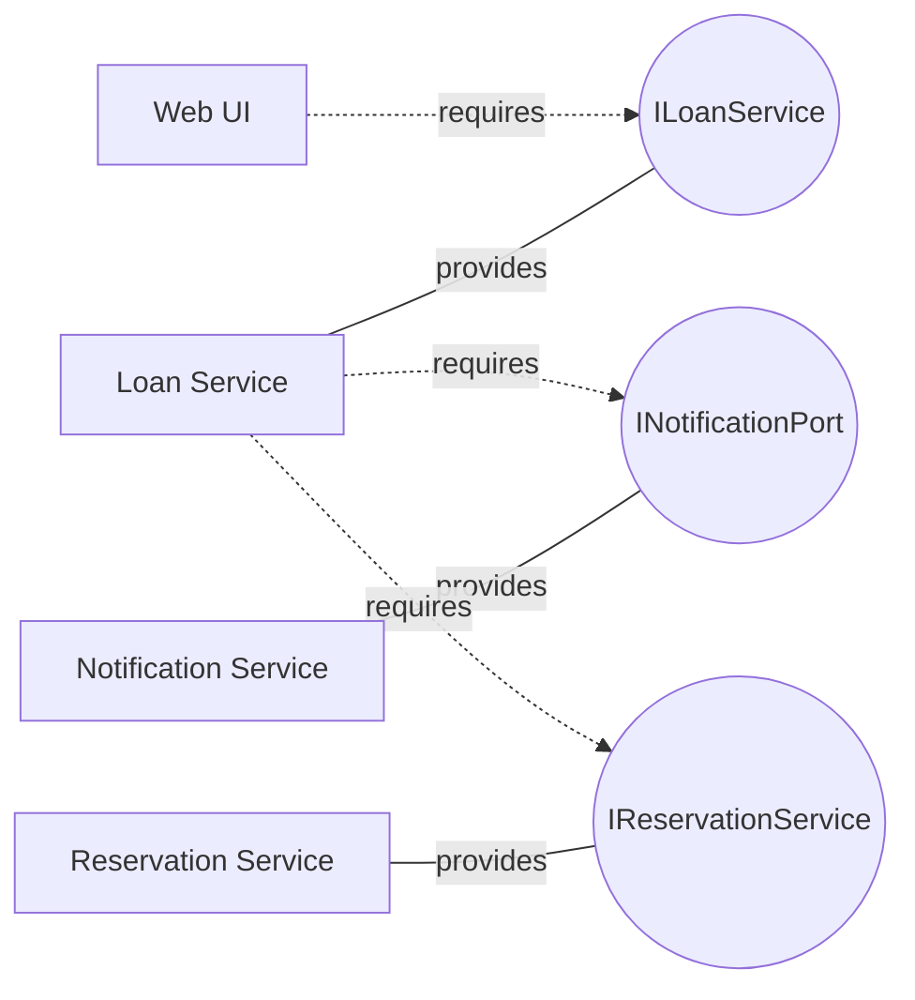

# Component Diagram: архітектура бібліотеки

## Інтерфейси (provided / required)

| Інтерфейс | Provided by | Required by | Призначення |
| :--- | :--- | :--- | :--- |
| `ILoanService` | Loan Service | Web UI | `borrowBook`, `returnBook` |
| `INotificationPort` | Notification Service | Loan Service | `sendLoanCreated`, `sendReminder` |
| IReservationService | Reservation Service | Loan Service | createReservation |
| IPaymentPort | Payment (зовнішній) | Loan Service | оплата штрафу |
| IOAuthPort | OAuth/Identity (зовнішній) | Web UI | автентифікація |

## Інтерфейси (Mermaid)

