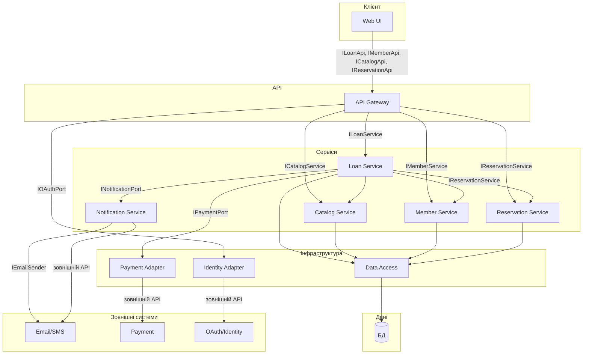
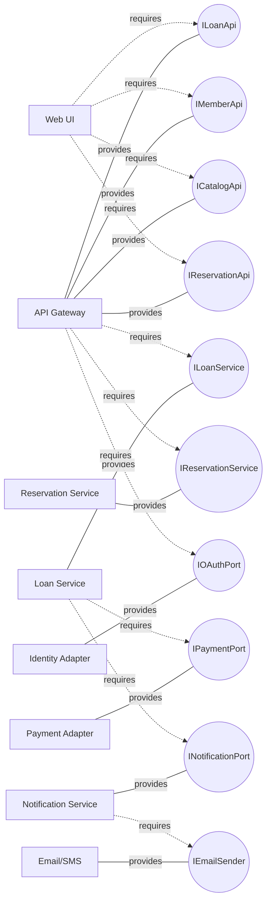

# Component Diagram: архітектура бібліотеки

## Інтерфейси (provided / required)

| Інтерфейс | Provided by | Required by | Призначення |
| :--- | :--- | :--- | :--- |
| `ILoanApi` | API Gateway | Web UI | `borrowBook`, `returnBook` через API |
| `IMemberApi` | API Gateway | Web UI | профіль читача |
| `ICatalogApi` | API Gateway | Web UI | каталог книг |
| `IReservationApi` | API Gateway | Web UI | бронювання |
| `ILoanService` | Loan Service | API Gateway | `borrowBook`, `returnBook` |
| `IMemberService` | Member Service | API Gateway | дані читача |
| `ICatalogService` | Catalog Service | API Gateway, Loan Service | каталог |
| `IReservationService` | Reservation Service | Loan Service, API Gateway | `createReservation` |
| `IPaymentPort` | Payment Adapter | Loan Service | оплата штрафу |
| `IOAuthPort` | Identity Adapter | API Gateway | автентифікація |
| `INotificationPort` | Notification Service | Loan Service | `sendLoanCreated`, `sendReminder` |
| `IEmailSender` | Email/SMS (зовнішній) | Notification Service | надсилання email/SMS |

## Інтерфейси (Mermaid)

